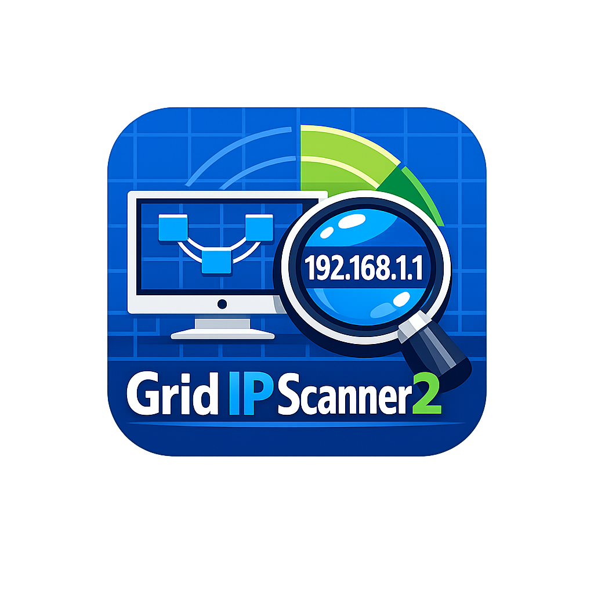

# 📝 [구글 블로거 포스팅 완벽 가이드] Grid IP Scanner2 공식 소개 및 배포 (v2.4.12)
> **공식 블로그**: [https://ahbiyoutvibe.blogspot.com/](https://ahbiyoutvibe.blogspot.com/)  
> **공식 깃허브**: [https://github.com/AhBiYout-all/grid-ip-scanner2](https://github.com/AhBiYout-all/grid-ip-scanner2)  
> **공식 배포사**: [https://ahbiyoutvibe.blogspot.com](https://ahbiyoutvibe.blogspot.com)  
> **최신 버전**: v2.4.12 | **작성일자**: 2026-11-01

---

## 📌 블로거(Blogger) 기본 설정 요약 (메타데이터)
* **맞춤 퍼머링크 (Permalink)**: `grid-ip-scanner2-visual-network-scanner`
* **검색 설명 (Search Description)**:
  > 16x16 시각화 그리드 맵, 다중 프로토콜 이름 원클릭 교체, 한글(2byte) 깨짐 방지 디코더, 9만 건 오프라인 OUI 제조사 식별, 4색 스냅샷 Diff 비교, 24시간 침입 감시, 원클릭 A4 보안감사 PDF 리포트와 원격 부팅(WoL)을 지원하는 초고속 차세대 네트워크 진단 도구 Grid IP Scanner2 (v2.4.12)를 소개합니다.

---

# 📝 [작성 모드 (서식 있는 텍스트)] 전용 본문
> **사용 방법**: 구글 블로거 글쓰기 화면 좌측 상단 연필 아이콘에서 **[작성 모드]**를 선택한 후, 아래 영역의 내용을 그대로 복사하여 붙여넣으세요.
> 규정 순서: **1. 제목 ➔ 2. 본문 ➔ 3. 업데이트 ➔ 4. 앱 그림 ➔ 5. 다운로드 ➔ 6. 버전정보 ➔ 7. 시스템 요구 사항 ➔ 8. 제작자 및 공식 채널 안내 ➔ 9. 전체 업데이트 ➔ 10. 추천 태그**

---

### 1. 제목
**[무료/초고속] 16x16 시각화 그리드 맵과 다중 프로토콜 뱃지 원클릭 적용을 탑재한 차세대 네트워크 스캐너: Grid IP Scanner2 (v2.4.12)**

---

### 2. 본문
안녕하세요, **AhBiYout**입니다.

네트워크 관리자, 시스템 엔지니어, 사내 전산 담당자라면 한 번쯤 **Advanced IP Scanner**나 **Angry IP Scanner** 같은 진단 도구를 사용해 보셨을 것입니다. 하지만 기존 도구들은 수백 개의 IP 주소를 단순한 텍스트 행(Row) 리스트로만 나열하여 전체 네트워크의 유휴 공간과 밀도를 직관적으로 파악하기 어려웠습니다. 또한 어제와 오늘의 네트워크 접속 장비 변화를 비교하거나, 경영진 및 감사 제출용 A4 보고서를 즉시 작성하는 데 큰 번거로움이 있었습니다.

이러한 현장의 갈증을 해소하기 위해 탄생한 **『Grid IP Scanner2』**는 C클래스(/24) 전체 254개 IP를 **16x16 매트릭스 그리드 맵**으로 실시간 시각화하며, 다중 프로토콜 탐색 배지 원클릭 이름 교체, 한글(2byte) 인코딩 깨짐 원천 방지, 9만 건 이상의 내장 하드웨어 제조사(OUI) 데이터베이스, 4색 스냅샷 Diff 비교, 24/7 침입자 백그라운드 감시, 원클릭 A4 규격 보안감사 PDF 출력, 원격 부팅(Wake-on-LAN)을 제공하는 고성능 네트워크 스캐너입니다.

#### 🚀 Grid IP Scanner2 핵심 기능
* **16x16 시각화 그리드 맵**: 전체 254개 노드의 활성/비활성/경고 상태를 신호등처럼 1초 만에 직관적으로 조망.
* **🏷️ 다중 프로토콜 뱃지 원클릭 대표 이름 지정**: SMB, NetBIOS, mDNS, UPnP, WSD, SNMP, Web Title 출처 뱃지 및 프로토콜 채널 목록 원클릭 장치 대표 이름 즉시 교체.
* **🔤 한글(2byte) 멀티바이트 깨짐 원천 차단**: UTF-8 및 CP949 / EUC-KR 네트워크 패킷 유효성 검증과 유니코드 정규식을 통한 한글 호스트명 무결점 디코딩.
* **🚦 3단계 시맨틱 버저닝 및 표준 문서 관리**: MAJOR.MINOR.PATCH 원칙에 따른 엄격한 버전 관리와 고도화된 기술 문서 체계 구축.
* **⏰ 정기 자동 네트워크 스캔 스케줄러**: 10분, 30분, 1시간, 매일 24시간 등 원하는 주기에 맞춘 무인 백그라운드 자동 스캔 및 `[Auto-Sched]` 스냅샷 자동 아카이빙.
* **90,168건 내장 오프라인 OUI 식별**: 인터넷이 차단된 폐쇄망에서도 1ms 미만의 속도로 삼성, 애플, 시스코, 시놀로지 등 하드웨어 제조사 식별.
* **과거 vs 현재 4색 스냅샷 Diff**: 기준점 대비 신규 접속(+NEW), 오프라인 전환(-OFF), 장비 식별 변경(!CHG), 정상 유지(=SAME)를 4색으로 정밀 진단.
* **24시간 무인 백그라운드 침입 감시**: 미등록 낯선 기기 탐지 시 즉각적인 데스크톱 팝업 및 오디오 비프 경보 송출.
* **경영진 제출용 A4 보안감사 PDF 리포트**: OUI 점유율 통계, 고위험 취약 포트 진단, 인벤토리 상세를 A4 최적화 조판으로 즉시 출력.

---

### 3. 업데이트 (v2.4.12 최신 릴리즈 하이라이트)
* **Android Manifest Merger `minSdkVersion` 충돌 해결**:
  - `org.apache.cordova:framework:14.0.1` 라이브러리의 요구 사양에 맞춰 `android/variables.gradle`의 `minSdkVersion`을 **`24` (Android 7.0 Nougat)**로 정식 조정하여 `uses-sdk:minSdkVersion 22 cannot be smaller than version 24` 빌드 오류 원천 해결.
* **Android CI/CD AAR 메타데이터 검증 결함 (`CheckAarMetadata`) 완전 해결**:
  - `androidx.core:1.15.0` 복원 및 전역 강제 의존성 지정으로 API 36 요구 충돌 해소.
* **Android Gradle 비권장 `--parallel` 인수 제거 및 스레드 안정화**:
  - `android/build.gradle`에 `gradle.startParameter.parallelProjectExecutionEnabled = false` 및 `maxWorkerCount = 2`를 명시하여 CLI 인수 오류 및 `DefaultWorkerLeaseService` 교착 현상을 해결.
* **소프트웨어 버전 관리(SemVer) 10대 타깃 v2.4.12 일괄 동기화 완료**.

---

### 4. 앱 그림 (UI 프리뷰 및 화면 구성)

```
+---------------------------------------------------------------------------------------+
|  [Grid IP Scanner2 v2.4.12]  [ 192.168.0.1 - 254 ]   [▶ 고속 스캔]   [📸 스냅샷 비교]   |
+------------------------------------------------------+--------------------------------+
|  [ 16x16 실시간 시각화 매트릭스 그리드 맵 ]            |  [ 장치 상세 프로필 패널 ]       |
|                                                      |  [가 100%] [가⁺ 115%]          |
|  [001] [002] [003] [004] [005] [006] ... [016]        |  ----------------------------- |
|  [017] [018] [019] [020] [021] [022] ... [032]        |  IP: 192.168.0.10              |
|  ...                                                 |  MAC: 00:11:32:8A:BC:DE        |
|  [🟢 +신규] [🔴 -오프라인] [🟡 !변동] [🔵 =기준]        |  제조사: Synology Incorporated |
|                                                      |  이름: 거실 메인 NAS [MDNS ↵]   |
|  * 254개 전체 C클래스 IP를 한눈에 밀도 조망            |  프로토콜 채널: [SMB], [mDNS]  |
|                                                      |  [⚡ WoL 매직 패킷 원격 부팅]    |
+------------------------------------------------------+--------------------------------+
|  [📄 A4 정밀 보안감사 PDF 리포트]  [📊 1:1 대조 스튜디오]  [🚨 24/7 낯선 기기 감시: PRO]  |
+---------------------------------------------------------------------------------------+
```

* **화면 1: 16x16 매트릭스 시각화 그리드**: 254개 전체 IP 노드 상태를 한눈에 조망.
* **화면 2: 다중 프로토콜 배지 & 원클릭 이름 교체**: 다양한 출처의 이름을 즉시 장치 이름으로 적용.
* **화면 3: 4색 스냅샷 Diff & 1:1 대조 스튜디오**: 과거 기준점과 현재 상태 정밀 대조.
* **화면 4: A4 규격 스마트 페이지네이션 보안 감사 리포트**: 경영진 및 감사 제출용 원클릭 PDF 출력.

---

### 5. 다운로드
필요하신 운영체제 환경에 맞춰 최신 빌드를 다운로드하세요:

* 📦 **Windows 정식 인스톨러**: `Grid_IP_Scanner2_v2.4.12_Setup.exe`  
  *(Windows 제어판 정식 등록, 방화벽 규칙 자동 등록, 바탕화면 바로가기 생성)*
* 🚀 **Windows 무설치 포터블**: `Grid_IP_Scanner2.exe` / `Grid_IP_Scanner2_v2.4.12_Portable.exe`  
  *(설치 과정 없이 USB에서 즉시 실행 가능한 단일 실행 바이너리)*
* 📱 **Android 스마트폰 설치 APK**: `Grid_IP_Scanner2_v2.4.12.apk`  
  *(안드로이드 스마트폰/태블릿 직접 설치용 고성능 패키지)*
* 🌐 **모바일 웹 & iOS PWA 패키지**: `Grid_IP_Scanner2_v2.4.12_Mobile_PWA.zip`  
* 🔗 **GitHub 공식 릴리즈 다운로드**: [https://github.com/AhBiYout-all/grid-ip-scanner2/releases](https://github.com/AhBiYout-all/grid-ip-scanner2/releases)

> 🛡️ **백신 오탐지 안내**: 본 소프트웨어는 순수 네트워크 진단 도구입니다. 안랩 V3나 Windows Defender에서 오탐될 경우 '검사 예외'로 등록하시면 안전하게 동작합니다.

---

### 6. 버전정보
* **프로그램 명칭**: Grid IP Scanner2
* **소프트웨어 버전**: v2.4.12
* **출시 일자**: 2026-11-01
* **라이선스**: Dual License (무료 커뮤니티 GPL v3 + Pro 상용 에디션)
* **30일 무료 체험 키**: `GRID-PRO-TRIAL-2026`

---

### 7. 시스템 요구 사항
* **Windows**: Windows 10 / Windows 11 (64-bit), RAM 2GB 이상
* **Android**: Android 7.0 (Nougat, API 24) 이상 (ARM64 / x86)
* **Web Browser**: Chrome, Edge, Safari, Firefox 등 최신 모던 브라우저

---

### 8. 제작자 및 공식 채널 안내
* **제작자 / 개발자**: AhBiYout
* **공식 구글 블로그**: [https://ahbiyoutvibe.blogspot.com/](https://ahbiyoutvibe.blogspot.com/)
* **공식 GitHub 저장소**: [https://github.com/AhBiYout-all/grid-ip-scanner2](https://github.com/AhBiYout-all/grid-ip-scanner2)
* **공식 이슈 및 문의**: [GitHub Issues 등록 바로가기](https://github.com/AhBiYout-all/grid-ip-scanner2/issues)

---

### 9. 전체 업데이트 (기능 개선 내용 요약)

* **[v2.4.12] (2026-11-01)**
  - Android Manifest Merger `minSdkVersion` 충돌 해결 (`minSdkVersion = 24` 조정). 10대 타깃 v2.4.12 버전 일괄 동기화.
* **[v2.4.11] (2026-11-01)**
  - Android AAR 메타데이터 검증 결함 해결 (`androidx.core:1.15.0` 호환성 복원 및 CheckAarMetadata 가드 적용). 플러그인 툴체인 AGP 8.9.1 정렬.
* **[v2.4.10] (2026-11-01)**
  - Android Gradle 비권장 '--parallel' 인수 제거 및 스레드 안정화. APK 산출물 위치 탐색기 및 디렉터리 사전 보장 로직 탑재.
* **[v2.4.9] (2026-11-01)**
  - SemVer 3단계 버전 관리 체계 및 자동화 스크립트 구축. 기술 문서 자산 대규모 개편 및 구글 블로거 템플릿 최신화.
* **[v2.4.8] (2026-11-01)**
  - 다중 프로토콜 이름 탐색 배지 원클릭 장치 이름 교체 기능 탑재. 장치 이름 한글 (2byte 멀티바이트) 인코딩 깨짐 원천 방지 및 통합 디코더 탑재.
* **[v2.4.7] (2026-10-27)**
  - CI/CD 클라우드 러너 Node.js 24 및 Java 21 표준 전환. 릴리스 산출물 패키징 무결성 확보.
* **[v2.4.6] (2026-10-26)**
  - 정기 자동 네트워크 스캔 스케줄러 탑재. 안드로이드 SplashScreen 최적화. Windows 제어판 정식 등록 및 듀얼 빌드 파이프라인 확립. 장치 프로필 가독성 개선 및 2단계 폰트 확대 시스템 탑재. 4색 스냅샷 Diff v2 및 1:1 대조 스튜디오 완성.
* **[v2.4.5] (2026-10-20)**
  - A4 규격 스마트 페이지네이션 PDF 리포트 엔진 고도화. 브라우저 자동 번역 팝업 차단.
* **[v2.4.3] (2026-10-14)**
  - 24/7 낯선 기기 무인 백그라운드 침입 감시(Intruder Watch Mode) 탑재.
* **[v2.4.2] (2026-10-14)**
  - 원클릭 원격 부팅 (Wake-on-LAN) UDP 매직 패킷 브로드캐스트 엔진 탑재.
* **[v2.4.1] (2026-10-14)**
  - 4색 스냅샷 Diff 비교 엔진 및 30일 무료 Pro 체험 라이선스 도입.
* **[v2.4.0] (2026-10-08)**
  - Soft Trust 유예 시스템 및 AES-256-GCM 네이티브 암호화 볼트 연동.
* **[v2.2.0] (2026-09-20)**
  - 9만 건 내장 오프라인 OUI 하드웨어 제조사 식별 DB 탑재.
* **[v2.0.0] (2026-09-01)**
  - 16x16 매트릭스 그리드 맵 실시간 시각화 인터페이스 도입. 고속 네이티브 스캔 엔진 전환.
* **[v1.0.0] (2026-08-15)**
  - 기본 서브넷 IP 탐색 및 활성 단말 리스트업 엔진 최초 개발.

---

### 10. 추천 태그
`Grid IP Scanner2, IP스캐너, 네트워크스캐너, NetworkScanner, IPScanner, 포터블, 침입탐지, WakeOnLAN, 보안감사, WoL, AhBiYout, 패킷분석, IT인벤토리, 네트워크관리`

*(태그 조건 검증: 한/영 혼용, 총 15개 태그, 135글자로 200글자 이내 충족)*

---
---

# 💻 [HTML 편집 모드] 전용 소스 코드
> **사용 방법**: 구글 블로거 글쓰기 화면 좌측 상단 연필 아이콘을 눌러 **`<> HTML 보기`**로 전환한 후, 아래 HTML 코드를 전체 복사하여 붙여넣으세요.

```html
<!-- Grid IP Scanner2 Official Blogger Template (v2.4.12) -->
<div style="font-family: -apple-system, BlinkMacSystemFont, 'Malgun Gothic', '맑은 고딕', 'Segoe UI', Roboto, sans-serif; line-height: 1.7; color: #1e293b; max-width: 840px; margin: 0 auto;">

  <!-- 1. 제목 -->
  <div style="background: linear-gradient(135deg, #0f172a 0%, #0369a1 100%); color: #ffffff; padding: 32px 24px; border-radius: 14px; margin-bottom: 28px; box-shadow: 0 10px 25px -5px rgba(2, 132, 199, 0.25);">
    <div style="display: inline-block; background: rgba(56, 189, 248, 0.2); border: 1px solid rgba(56, 189, 248, 0.4); color: #38bdf8; font-size: 11px; font-weight: 800; padding: 4px 10px; border-radius: 20px; text-transform: uppercase; letter-spacing: 1px; margin-bottom: 12px;">
      v2.4.12 Official Release
    </div>
    <h1 style="font-size: 25px; font-weight: 900; margin: 0 0 10px 0; letter-spacing: -0.5px; line-height: 1.35; color: #ffffff;">
      Grid IP Scanner2 — 16x16 시각화 그리드 기반 차세대 초고속 네트워크 스캐너 (v2.4.12)
    </h1>
    <p style="font-size: 14px; color: #cbd5e1; margin: 0; line-height: 1.6;">
      다중 프로토콜 뱃지 원클릭 적용 &bull; 한글(2byte) 깨짐 원천 차단 &bull; 9만 건 내장 OUI 제조사 식별 &bull; 4색 스냅샷 Diff &bull; 24/7 침입 감시 &bull; A4 보안감사 PDF 리포트
    </p>
  </div>

  <!-- 2. 본문 -->
  <div style="margin-bottom: 30px;">
    <h2 style="font-size: 19px; font-weight: 800; color: #0f172a; border-left: 4.5px solid #0284c7; padding-left: 10px; margin: 0 0 14px 0;">
      📌 본문 소개
    </h2>
    <p style="font-size: 14.5px; color: #334155; margin-bottom: 14px;">
      안녕하세요, <b>AhBiYout</b>입니다.
    </p>
    <p style="font-size: 14.5px; color: #334155; margin-bottom: 14px; line-height: 1.75;">
      네트워크 관리자라면 IP 주소를 단순한 텍스트 행 리스트로만 나열하여 전체 네트워크 밀도를 한눈에 파악하기 어려운 도구들에 답답함을 느끼셨을 것입니다.
    </p>
    <p style="font-size: 14.5px; color: #334155; margin-bottom: 18px; line-height: 1.75;">
      <b>『Grid IP Scanner2』</b>는 C클래스(/24) 전체 254개 IP를 <b>16x16 매트릭스 그리드 맵</b>으로 실시간 시각화하며, 다중 프로토콜 뱃지 원클릭 이름 교체, 한글(2byte) 인코딩 완벽 보호, 9만 건 오프라인 OUI 제조사 식별, 4색 스냅샷 Diff 비교, 24시간 침입 감시, A4 PDF 보안감사 보고서 출력을 제공하는 고성능 스캐너입니다.
    </p>
  </div>

  <!-- 3. 업데이트 -->
  <div style="background: #f8fafc; border: 1px solid #e2e8f0; border-radius: 12px; padding: 22px; margin-bottom: 30px;">
    <h2 style="font-size: 18px; font-weight: 800; color: #0284c7; margin: 0 0 14px 0; display: flex; align-items: center; gap: 8px;">
      🚀 업데이트 하이라이트 (v2.4.12)
    </h2>
    <ul style="margin: 0; padding-left: 20px; font-size: 14px; color: #334155; line-height: 1.8;">
      <li><b>Android Manifest Merger minSdkVersion 충돌 해결</b>: <code>minSdkVersion = 24</code> (Android 7.0 Nougat) 설정으로 Cordova 14 플러그인 요구 사양 완벽 충족.</li>
      <li><b>Android AAR 메타데이터 검증 결함 해결</b>: androidx.core:1.15.0 정합성 복원 및 CheckAarMetadata 가드 적용.</li>
      <li><b>Android Gradle 비권장 '--parallel' 인수 제거</b>: 빌드스크립트 매개변수 및 workers.max 최적화로 빌드 스레드 교착 상태 완전 해소.</li>
      <li><b>Android APK 산출물 위치 탐색기 및 디렉터리 사전 보장</b>: <code>ensureApkOutputDir</code> 태스크 및 <code>afterEvaluate</code> 자동 복제로 'No such file or directory' 오류 원천 차단.</li>
    </ul>
  </div>

  <!-- 4. 앱 그림 -->
  <div style="margin-bottom: 30px;">
    <h2 style="font-size: 19px; font-weight: 800; color: #0f172a; border-left: 4.5px solid #0284c7; padding-left: 10px; margin: 0 0 16px 0;">
      🖼️ 앱 그림 (UI 스크린샷 및 화면 구성)
    </h2>
    <div style="text-align: center; margin-bottom: 16px; background: #0f172a; padding: 16px; border-radius: 12px; border: 1px solid #1e293b;">
      
    </div>
    <div style="display: grid; grid-template-columns: 1fr 1fr; gap: 12px; font-size: 13px; color: #475569;">
      <div style="background: #f1f5f9; padding: 12px; border-radius: 8px; border: 1px solid #e2e8f0;"><b>1. 16x16 매트릭스 그리드</b>: 254개 IP 노드 상태 실시간 시각화</div>
      <div style="background: #f1f5f9; padding: 12px; border-radius: 8px; border: 1px solid #e2e8f0;"><b>2. 다중 프로토콜 뱃지</b>: [mDNS], [UPnP], [SMB] 원클릭 이름 교체</div>
      <div style="background: #f1f5f9; padding: 12px; border-radius: 8px; border: 1px solid #e2e8f0;"><b>3. 4색 스냅샷 Diff</b>: 신규/오프라인/변동 장비 정밀 대조</div>
      <div style="background: #f1f5f9; padding: 12px; border-radius: 8px; border: 1px solid #e2e8f0;"><b>4. A4 보안감사 PDF</b>: 페이지당 30개 노드 수납 스마트 리포트</div>
    </div>
  </div>

  <!-- 5. 다운로드 -->
  <div style="background: linear-gradient(to right, #f0f9ff, #e0f2fe); border: 1.5px solid #bae6fd; border-radius: 12px; padding: 22px; margin-bottom: 30px;">
    <h2 style="font-size: 18px; font-weight: 800; color: #0369a1; margin: 0 0 14px 0;">
      💾 소프트웨어 다운로드
    </h2>
    <div style="display: flex; flex-direction: column; gap: 10px; font-size: 14px;">
      <a href="https://github.com/AhBiYout-all/grid-ip-scanner2/releases" target="_blank" style="display: block; background: #0284c7; color: #ffffff; text-decoration: none; padding: 12px 18px; border-radius: 8px; font-weight: 800; text-align: center; box-shadow: 0 4px 10px rgba(2, 132, 199, 0.3);">
        📦 Windows 정식 인스톨러 (Grid_IP_Scanner2_v2.4.12_Setup.exe) 다운로드
      </a>
      <a href="https://github.com/AhBiYout-all/grid-ip-scanner2/releases" target="_blank" style="display: block; background: #0f172a; color: #ffffff; text-decoration: none; padding: 12px 18px; border-radius: 8px; font-weight: 800; text-align: center;">
        🚀 Windows 무설치 포터블 (Grid_IP_Scanner2_v2.4.12_Portable.exe) 다운로드
      </a>
      <a href="https://github.com/AhBiYout-all/grid-ip-scanner2/releases" target="_blank" style="display: block; background: #16a34a; color: #ffffff; text-decoration: none; padding: 12px 18px; border-radius: 8px; font-weight: 800; text-align: center;">
        📱 Android 스마트폰 설치 APK (Grid_IP_Scanner2_v2.4.12.apk) 다운로드
      </a>
    </div>
  </div>

  <!-- 6. 버전정보 -->
  <div style="margin-bottom: 30px; background: #ffffff; border: 1px solid #e2e8f0; border-radius: 10px; padding: 18px;">
    <h3 style="font-size: 16px; font-weight: 800; color: #0f172a; margin: 0 0 10px 0;">ℹ️ 버전 정보</h3>
    <ul style="margin: 0; padding-left: 20px; font-size: 13.5px; color: #475569; line-height: 1.7;">
      <li><b>프로그램 명칭</b>: Grid IP Scanner2</li>
      <li><b>소프트웨어 버전</b>: v2.4.12</li>
      <li><b>출시 일자</b>: 2026-11-01</li>
      <li><b>라이선스</b>: Dual License (Community GPL v3 + Pro Commercial)</li>
      <li><b>30일 무료 체험 키</b>: <code>GRID-PRO-TRIAL-2026</code></li>
    </ul>
  </div>

  <!-- 7. 시스템 요구 사항 -->
  <div style="margin-bottom: 30px; background: #ffffff; border: 1px solid #e2e8f0; border-radius: 10px; padding: 18px;">
    <h3 style="font-size: 16px; font-weight: 800; color: #0f172a; margin: 0 0 10px 0;">⚙️ 시스템 요구 사항</h3>
    <ul style="margin: 0; padding-left: 20px; font-size: 13.5px; color: #475569; line-height: 1.7;">
      <li><b>Windows</b>: Windows 10 / Windows 11 (64-bit 권장), RAM 2GB 이상</li>
      <li><b>Android</b>: Android 7.0 (Nougat, API 레벨 24) 이상 (ARM64 / x86)</li>
      <li><b>Web Browser</b>: Chrome, Edge, Safari, Firefox 등 최신 모던 브라우저</li>
    </ul>
  </div>

  <!-- 8. 제작자 및 공식 채널 안내 -->
  <div style="margin-bottom: 30px; background: #f8fafc; border: 1px solid #cbd5e1; border-radius: 10px; padding: 18px;">
    <h3 style="font-size: 16px; font-weight: 800; color: #0f172a; margin: 0 0 10px 0;">👤 제작자 및 공식 채널 안내</h3>
    <ul style="margin: 0; padding-left: 20px; font-size: 13.5px; color: #334155; line-height: 1.75;">
      <li><b>제작자 / 개발자</b>: AhBiYout</li>
      <li><b>공식 구글 블로그</b>: <a href="https://ahbiyoutvibe.blogspot.com/" target="_blank" style="color: #0284c7; font-weight: bold;">https://ahbiyoutvibe.blogspot.com/</a></li>
      <li><b>공식 GitHub 저장소</b>: <a href="https://github.com/AhBiYout-all/grid-ip-scanner2" target="_blank" style="color: #0284c7; font-weight: bold;">https://github.com/AhBiYout-all/grid-ip-scanner2</a></li>
      <li><b>이슈 및 문의</b>: <a href="https://github.com/AhBiYout-all/grid-ip-scanner2/issues" target="_blank" style="color: #0284c7;">GitHub Issues 등록 바로가기</a></li>
    </ul>
  </div>

  <!-- 9. 전체 업데이트 -->
  <div style="margin-bottom: 30px; background: #ffffff; border: 1px solid #e2e8f0; border-radius: 10px; padding: 18px;">
    <h3 style="font-size: 16px; font-weight: 800; color: #0f172a; margin: 0 0 12px 0;">📜 주요 업데이트 연혁 (Release History)</h3>
    <div style="font-size: 13px; color: #475569; line-height: 1.7; max-height: 320px; overflow-y: auto; padding-right: 8px;">
      <p style="margin: 0 0 8px 0;"><b>[v2.4.12] (2026-11-01)</b><br />Android Manifest Merger minSdkVersion 충돌 해결 (minSdkVersion = 24 조정).</p>
      <p style="margin: 0 0 8px 0;"><b>[v2.4.11] (2026-11-01)</b><br />Android AAR 메타데이터 검증 결함 해결 (androidx.core:1.15.0 호환성 복원 및 CheckAarMetadata 가드 적용). 플러그인 툴체인 AGP 8.9.1 정렬.</p>
      <p style="margin: 0 0 8px 0;"><b>[v2.4.10] (2026-11-01)</b><br />Android Gradle 비권장 '--parallel' 인수 제거 및 스레드 안정화. APK 산출물 위치 탐색기 및 디렉터리 사전 보장 로직 탑재.</p>
      <p style="margin: 0 0 8px 0;"><b>[v2.4.9] (2026-11-01)</b><br />SemVer 3단계 버전 관리 체계 및 자동화 스크립트 구축. 구글 블로거 템플릿 최신화.</p>
      <p style="margin: 0 0 8px 0;"><b>[v2.4.8] (2026-11-01)</b><br />다중 프로토콜 이름 탐색 배지 원클릭 이름 교체 및 한글 (2byte) 인코딩 깨짐 원천 방지.</p>
      <p style="margin: 0 0 8px 0;"><b>[v2.4.7] (2026-10-27)</b><br />CI/CD 클라우드 러너 Node.js 24 및 Java 21 표준 전환, 릴리스 산출물 패키징 무결성 확보.</p>
      <p style="margin: 0 0 8px 0;"><b>[v2.4.6] (2026-10-26)</b><br />정기 자동 네트워크 스캔 스케줄러 탑재, 4색 스냅샷 Diff v2 완성.</p>
      <p style="margin: 0 0 8px 0;"><b>[v2.4.3] (2026-10-14)</b><br />24/7 낯선 기기 무인 백그라운드 침입 감시(Intruder Watch Mode) 탑재.</p>
      <p style="margin: 0 0 8px 0;"><b>[v2.4.2] (2026-10-14)</b><br />원클릭 원격 부팅 (Wake-on-LAN) 엔진 탑재.</p>
      <p style="margin: 0 0 8px 0;"><b>[v2.2.0] (2026-09-20)</b><br />9만 건 내장 오프라인 OUI 하드웨어 제조사 식별 DB 탑재.</p>
      <p style="margin: 0 0 8px 0;"><b>[v2.0.0] (2026-09-01)</b><br />16x16 매트릭스 그리드 맵 실시간 시각화 인터페이스 및 네이티브 스캔 엔진 도입.</p>
      <p style="margin: 0;"><b>[v1.0.0] (2026-08-15)</b><br />기본 서브넷 IP 탐색 및 활성 단말 리스트업 엔진 최초 개발.</p>
    </div>
  </div>

  <!-- 10. 추천 태그 -->
  <div style="background: #f1f5f9; border: 1px solid #cbd5e1; border-radius: 8px; padding: 14px; font-size: 12.5px; color: #475569; font-weight: bold;">
    🏷️ 추천 태그: <span style="color: #0284c7;">Grid IP Scanner2, IP스캐너, 네트워크스캐너, NetworkScanner, IPScanner, 포터블, 침입탐지, WakeOnLAN, 보안감사, WoL, AhBiYout, 패킷분석, IT인벤토리, 네트워크관리</span>
  </div>

</div>
```
